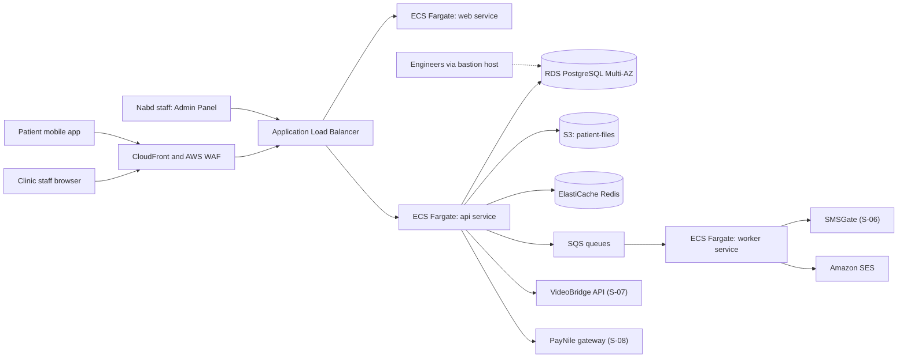

# Nabd Health: Company Fact Base

| Field | Value |
|---|---|
| Document ID | NH-FB-001 |
| Version | 1.0 |
| Status | Baseline (simulated client discovery output) |
| Fact base date | 25 October 2026 |
| Prepared by | ISMS Lead Implementer (consultant) |
| Reviewed by | Omar Nasser, CTO (simulated) |
| Classification | Internal (simulated client confidential) |

> **Notice:** Nabd Health is a fictional company created for a simulated ISO/IEC 27001:2022 implementation project. All names, numbers, systems, suppliers (other than well-known public vendors) and events are invented. Any resemblance to a real organization is coincidental.

## How to use this document

This file is the single source of truth about the company. Every ISMS document (scope, risk register, Statement of Applicability, policies, audit report) must stay consistent with it. If you change a fact here, update the change log in Section 20 and review every document that depends on it.

Gap IDs (G-01 and so on) in Section 17 are referenced later by the risk register, the Statement of Applicability, the internal audit findings, and the corrective action log.

---

## 1. Organization overview

| Item | Detail |
|---|---|
| Legal name | Nabd Health for Digital Health Solutions S.A.E. |
| Trade name | Nabd Health |
| Founded | March 2021 |
| Headquarters | 2nd floor, multi-tenant office building, 5th Settlement, New Cairo, Egypt |
| Headcount | 60 employees plus 3 outsourced mobile developers |
| Working model | Hybrid. Office days Sunday to Tuesday for most staff, remote Wednesday and Thursday. About 40 percent of staff work remotely on any given day |
| Funding | Seed round (2021), Series A (2024). Investors request security due diligence |
| Website | nabdhealth.example (platform at app.nabdhealth.example, admin panel at admin.nabdhealth.example) |
| Mission | Give private clinics and small hospitals in Egypt a modern, affordable digital platform for appointments, patient records, telemedicine, and billing |

## 2. Business and customers

### 2.1 Product: the Nabd Platform

| Module | Description | Users |
|---|---|---|
| Nabd Booking | Online appointment booking, reminders by SMS and email | Clinic staff, patients |
| Nabd Records | Electronic patient records: demographics, visit notes, prescriptions, lab results, uploaded scans and documents | Doctors, nurses, clinic admins |
| Nabd Connect | Telemedicine video visits and chat between patient and doctor | Doctors, patients |
| Nabd Billing | Invoices, card and wallet payments, insurance claim exports | Clinic accountants, patients |
| Nabd Patient App | Mobile app (iOS and Android) for patients: bookings, records access, prescriptions, video visits, payments | Patients |
| Nabd Admin Panel | Internal web tool used by Nabd support and operations staff to manage clinic accounts and troubleshoot issues | Nabd staff only |

### 2.2 Customers and volumes

| Metric | Value (October 2026) |
|---|---|
| Private clinics | 118 |
| Hospital groups | 6 (14 hospitals in total) |
| Clinic and hospital staff accounts | About 9,500 |
| Patient records stored | About 412,000 |
| Patient app monthly active users | About 65,000 |
| Video visits per day | About 1,200 |
| Patient files in object storage | About 3.1 million files (about 6.5 TB) |
| Annual recurring revenue | EGP 96 million (simulated) |

### 2.3 Why ISO 27001 now

1. Three hospital groups in active tenders require ISO/IEC 27001 certification or a credible plan to obtain it.
2. Hospital customers send long security questionnaires, and the company answers them informally.
3. Egyptian Personal Data Protection Law No. 151 of 2020 (PDPL) raises compliance pressure. The company is both a processor (for clinic data) and a controller (for its own staff, patient app accounts, and marketing data).
4. Series A investors asked for security due diligence before the Series B discussion.
5. A phishing incident in March 2026 (Section 12.6) alarmed the board.

---

## 3. Organization structure and people

### 3.1 Headcount by department

| Department | Headcount | Notes |
|---|---|---|
| Executive | 5 | CEO, COO, CTO, CFO, CPO |
| Engineering | 21 | Engineering Manager 1, Platform/DevOps 3, Backend 7, Frontend 4, Mobile 2, QA 3, Data 1 |
| Product and Design | 4 | Product managers 2, UX designers 2 |
| Support and Operations | 13 | Head 1, Tier 1 support 7, Tier 2 support 3, Implementation specialists 2 |
| Sales and Marketing | 10 | Head 1, Account executives 4, Marketing 3, Sales operations 1, Partnerships 1 |
| Finance, HR and Admin | 7 | Finance manager 1, Accountant 1, HR manager 1, HR officer 1, IT support officer 1, Office manager 1, Receptionist/admin 1 |
| **Total** | **60** | |
| Outsourced mobile developers | 3 | Supplied by Pixelwave Software (S-05), work remotely on their own laptops |

### 3.2 Key people (fictional)

| Name | Role | ISMS relevance |
|---|---|---|
| Karim Salah | CEO | Top management. Proposed ISMS sponsor |
| Dina Mostafa | COO | Owns Support and Operations, HR, Admin. Proposed management review member |
| Omar Nasser | CTO | Owns Engineering and the AWS organization. Holds the AWS root account |
| Heba Youssef | CFO | Owns Finance and supplier contracts. Handles cyber insurance |
| Layla Hamdy | CPO | Owns Product and Design |
| Sara Lotfy | Engineering Manager | Owns the development process |
| Ahmed Rizk | Platform/DevOps Lead | De facto security contact. Manages AWS, CI/CD, and the bastion host |
| Nour El-Din Abbas | Head of Support and Operations | Owns the support process and Admin Panel use |
| Mariam Khalil | HR Manager | Owns hiring, onboarding, offboarding |
| Mahmoud Samir | IT Support Officer | Only IT person. Manages laptops, Google Workspace, accounts |
| Rania Fouad | Office Manager | Owns office access fobs, visitors, building liaison |
| Hossam Tarek | Head of Sales and Marketing | Owns customer security questionnaires with Product |

### 3.3 Governance gaps today

- No CISO or information security manager. Ahmed Rizk handles security informally on top of his DevOps role.
- No Data Protection Officer. The CTO acts as privacy contact by default.
- No information security committee. Security is discussed ad hoc in the weekly management meeting.
- Legal advice is provided by an external law firm (Supplier S-11) on request.

### 3.4 Proposed ISMS roles (for the project)

| ISMS role | Proposed holder |
|---|---|
| Top management and ISMS sponsor | Karim Salah (CEO) |
| ISMS Manager (to be appointed) | Ahmed Rizk, with 50 percent time allocation during implementation |
| Risk owners | Department heads and the CTO |
| Internal auditor | Independent person, to be appointed (see audit plan) |
| Lead Implementer | You (consultant role in the simulation) |

---

## 4. Locations

| ID | Location | Description |
|---|---|---|
| L-01 | Cairo office | 2nd floor, shared building in 5th Settlement, New Cairo. About 450 square meters, open-plan with 3 meeting rooms, a small server and network cupboard, and a reception area. Building has a landlord-run lobby security desk and elevators |
| L-02 | Remote work locations | Staff homes across Greater Cairo and Alexandria. No fixed list |
| L-03 | AWS Middle East region (Bahrain, me-south-1) | All production and non-production cloud workloads |
| L-04 | Pixelwave Software office | Supplier office in Giza where outsourced mobile developers sit when not working from home |

---

## 5. Technology architecture

### 5.1 Overview

The Nabd Platform is a multi-tenant SaaS application hosted entirely on AWS in the Bahrain region. There are no on-premises servers. The office hosts only a router, a switch, and Wi-Fi access points.

### 5.2 Architecture diagram



### 5.3 AWS organization and accounts

| Account | Purpose | Notes |
|---|---|---|
| nabd-management | AWS Organizations management account, billing | Root user MFA enabled (virtual MFA on CTO's phone). Used rarely |
| nabd-prod | Production workloads | GuardDuty enabled. S3 Block Public Access enabled at account level |
| nabd-nonprod | Development and staging workloads together | Both environments in one account. GuardDuty not enabled |

- Region: me-south-1 only. A service control policy denies other regions, except for global services.
- Infrastructure is defined in Terraform (repository `nabd-infra`). Terraform state is stored in an S3 bucket with versioning. Only DevOps staff can apply changes.
- AWS Config and Security Hub are not enabled.
- CloudTrail: organization trail to a dedicated S3 bucket, retention 1 year, log file validation on.

### 5.4 Network design (production)

- One VPC with three subnet tiers across two availability zones: public (ALB, NAT gateways), private (ECS tasks, Redis), isolated (RDS).
- Security groups restrict RDS and Redis to the ECS task security group and the bastion security group.
- The admin panel is served by the same ALB and is reachable from the public internet. It is protected by login only, with no IP allow-list.
- A bastion host (EC2 t3.small, Amazon Linux) in a public subnet allows engineers to reach the database and ECS tasks. Access is by SSH with key pairs.
- No site-to-site VPN. No client VPN. Office network and cloud are not connected.

### 5.5 Application components

| Component | Technology | Hosting |
|---|---|---|
| Web frontend | React single-page app | ECS Fargate (nginx container), behind CloudFront |
| API | Node.js (TypeScript), REST, deployed as containers | ECS Fargate, 3 tasks across 2 AZs |
| Workers | Node.js job processors | ECS Fargate, 2 tasks |
| Database | PostgreSQL 15 | RDS Multi-AZ, encrypted at rest (AWS-managed KMS key) |
| Cache and sessions | Redis | ElastiCache, in-transit encryption on |
| File storage | Uploaded patient files, lab results, scans | S3 bucket `nabd-prod-patient-files`, SSE-S3 encryption, versioning on |
| Queues | Email, SMS, report generation | SQS |
| Email | Transactional email | Amazon SES |
| Mobile app | React Native, iOS and Android | Built by Nabd mobile team and Pixelwave contractors, distributed through App Store and Google Play |
| Admin panel | Internal React and Node app | Same cluster, separate service |
| Monitoring | CloudWatch metrics and alarms, Sentry for application errors | Alarms notify a Slack channel |

### 5.6 Authentication in the product

| User type | Authentication | Notes |
|---|---|---|
| Clinic and hospital staff | Email and password. Optional TOTP two-factor authentication, chosen by each user | Not enforced by the platform. About 22 percent of clinic staff accounts use it |
| Patients | Phone number with one-time SMS code | Code valid 10 minutes |
| Nabd staff in Admin Panel | Email and password, optional TOTP | See G-01 |
| Role model | Role-based access per clinic (admin, doctor, nurse, receptionist, accountant) | Tenant isolation enforced in application code by clinic ID |

### 5.7 Cryptography and secrets

- TLS 1.2 or higher on CloudFront and ALB. Certificates from AWS Certificate Manager with auto-renewal.
- RDS and S3 encrypted at rest using AWS-managed keys. No customer-managed KMS keys. No application-level field encryption for patient notes.
- Application secrets (database passwords, API keys for suppliers) are in AWS Secrets Manager. Some CI/CD secrets are in GitHub Actions secrets. No scheduled secret rotation.
- Passwords in the product are hashed with bcrypt.

---

## 6. Environments and development process

| Environment | Account | Data | Access |
|---|---|---|---|
| Development | nabd-nonprod | Synthetic data | All engineers |
| Staging | nabd-nonprod | **Monthly copy of production database, not masked** | All engineers, QA, selected support staff |
| Production | nabd-prod | Real data | DevOps (3), CTO. Five engineers have read-only database access through the bastion |

### 6.1 Development lifecycle

- Source code in GitHub (organization `nabd-health`, 14 private repositories). Terraform in `nabd-infra`.
- Workflow: feature branches and pull requests into `main`. Branch protection requires 1 approving review and a passing build. **Repository admins can bypass protection.**
- CI/CD: GitHub Actions builds containers, runs unit tests, pushes to Amazon ECR, deploys to staging automatically and to production on manual approval.
- Dependency updates: Dependabot enabled on 6 of 14 repositories.
- No static code analysis, no container image scanning, no dynamic testing, and no penetration test has ever been performed.
- Mobile releases are built and signed by Nabd engineers. The signing keys and store credentials are held by two engineers.
- Outsourced mobile developers (Pixelwave) have write access to the two mobile repositories and use their own laptops.

### 6.2 Change management

- Normal changes go through pull request and approval, tracked in Jira.
- Production hotfixes are sometimes pushed directly to `main` by the CTO using admin bypass, then reviewed afterward (if at all). Four occurrences in the last 6 months.
- No change advisory process, no maintenance window policy, and no rollback test record.
- An August 2026 outage (3 hours) was caused by a faulty deployment (Section 12.6).

---

## 7. Data inventory and classification

Nabd Health currently has no formal classification scheme. The table below is the implementer's discovery summary and will be used to create one.

| ID | Data set | Location | Owner | Sensitivity (proposed) | Volume |
|---|---|---|---|---|---|
| D-01 | Patient demographics and contact details | RDS | CPO | Confidential (health-related personal data) | 412,000 records |
| D-02 | Visit notes, diagnoses, prescriptions | RDS | CPO | Highly confidential (sensitive health data) | About 2.8 million entries |
| D-03 | Uploaded patient files (labs, scans, documents) | S3 patient-files | CPO | Highly confidential | About 6.5 TB |
| D-04 | Telemedicine session metadata | RDS | CPO | Confidential | About 1,200 per day |
| D-05 | Video and audio streams | VideoBridge (supplier). Not recorded by Nabd | CPO | Highly confidential, transient | Live only |
| D-06 | Payment transaction records (tokens, amounts, status) | RDS, PayNile | CFO | Confidential. No card numbers stored by Nabd | About 38,000 per month |
| D-07 | Clinic customer contracts and billing data | Google Drive, HubSpot | CFO | Confidential | 124 customers |
| D-08 | Employee records and payroll | Google Drive (HR folder), payroll provider export | HR Manager | Confidential | 60 employees |
| D-09 | Source code and infrastructure code | GitHub | CTO | Confidential | 15 repositories |
| D-10 | Application and audit logs | CloudWatch, S3 | DevOps Lead | Internal | See Section 12.3 |
| D-11 | Support tickets and chat transcripts (may contain patient details) | Freshdesk | Head of Support | Confidential | About 40,000 tickets per year |
| D-12 | Marketing leads and website analytics | HubSpot, analytics tool | Head of Sales and Marketing | Internal | About 8,000 contacts |
| D-13 | Database backups and snapshots | RDS snapshots, S3 export bucket | DevOps Lead | Highly confidential (same as source) | See Section 12.2 |
| D-14 | Secrets and credentials | Secrets Manager, GitHub secrets, shared sheet (see G-10) | DevOps Lead | Highly confidential | N/A |

### 7.1 Key data flows

1. **Clinic staff to platform:** browser over HTTPS to CloudFront, ALB, API, RDS and S3.
2. **Patient to platform:** mobile app over HTTPS to the same path. Login by phone OTP, with SMS sent through SMSGate.
3. **Video visit:** API creates a session with VideoBridge. Audio and video travel between participants and VideoBridge. Nabd stores session metadata only.
4. **Payment:** patient or clinic pays through PayNile hosted page. Nabd receives a token and status by webhook.
5. **Support access:** Nabd support staff log in to the Admin Panel, search any clinic and patient, and can open full patient records to troubleshoot.
6. **Engineer access:** engineers connect through the bastion host to the production database for investigations, sometimes with the shared read-only credential (G-10).
7. **Staging refresh:** DevOps restores the latest production snapshot into staging monthly, without masking.
8. **Support tickets:** support agents sometimes paste patient names or screenshots into Freshdesk tickets.

### 7.2 Data retention and deletion today

- No documented retention schedule.
- When a clinic cancels, its data stays in the database and S3 indefinitely. Account is flagged inactive only.
- Backups retained as described in Section 12.2.

---

## 8. Asset inventory (summary)

Asset IDs use the format `A-<category>-<number>`. This is the baseline. The risk register will reference these IDs.

### 8.1 Cloud and infrastructure assets

| ID | Asset | Owner | Location | Criticality |
|---|---|---|---|---|
| A-CL-01 | AWS Organization (management account) | CTO | AWS | High |
| A-CL-02 | AWS account nabd-prod | DevOps Lead | AWS | Critical |
| A-CL-03 | AWS account nabd-nonprod | DevOps Lead | AWS | Medium |
| A-CL-04 | RDS PostgreSQL production cluster | DevOps Lead | AWS | Critical |
| A-CL-05 | S3 bucket patient-files | DevOps Lead | AWS | Critical |
| A-CL-06 | ECS production cluster (web, api, worker, admin) | DevOps Lead | AWS | Critical |
| A-CL-07 | CloudFront distribution and AWS WAF | DevOps Lead | AWS | High |
| A-CL-08 | ElastiCache Redis | DevOps Lead | AWS | High |
| A-CL-09 | Bastion host | DevOps Lead | AWS | High |
| A-CL-10 | Amazon ECR repositories | DevOps Lead | AWS | High |
| A-CL-11 | AWS Secrets Manager | DevOps Lead | AWS | Critical |
| A-CL-12 | CloudWatch logs and CloudTrail bucket | DevOps Lead | AWS | High |
| A-CL-13 | Staging environment (with production data copy) | DevOps Lead | AWS | High |
| A-CL-14 | Terraform state bucket | DevOps Lead | AWS | High |

### 8.2 Applications and SaaS

| ID | Asset | Owner | Users | Criticality |
|---|---|---|---|---|
| A-AP-01 | Nabd Platform (web and API) | CTO | Clinics, patients | Critical |
| A-AP-02 | Nabd Patient App (iOS, Android) | CPO | Patients | High |
| A-AP-03 | Nabd Admin Panel | Head of Support | Support, operations, selected engineers (19 accounts) | Critical |
| A-AP-04 | GitHub organization | CTO | Engineering, Pixelwave (3), 41 members in total including 2 former contractors | Critical |
| A-AP-05 | Google Workspace (email, Drive, Meet) | IT Support Officer | All staff | Critical |
| A-AP-06 | Slack | IT Support Officer | All staff | Medium |
| A-AP-07 | Jira and Confluence | Engineering Manager | Engineering, product, support | Medium |
| A-AP-08 | Freshdesk | Head of Support | Support, operations | High |
| A-AP-09 | HubSpot CRM | Head of Sales and Marketing | Sales, marketing, finance | Medium |
| A-AP-10 | Figma | CPO | Product and design | Low |
| A-AP-11 | Sentry | Engineering Manager | Engineering | Medium |
| A-AP-12 | Payroll and accounting software | CFO | Finance, HR | High |

Password management: no company-wide password manager. Some engineers use free personal Bitwarden accounts. Credentials for shared tools are kept in a shared Google Sheet (see G-10).

### 8.3 End-user devices

| ID | Asset | Quantity | Notes |
|---|---|---|---|
| A-EP-01 | MacBook laptops (engineering, product, executives) | 30 | FileVault enabled on 24 of 30 |
| A-EP-02 | Windows laptops (sales, finance, HR, some support) | 22 | BitLocker enabled on 9 of 22. Windows Defender only |
| A-EP-03 | Windows desktops (reception, support floor) | 8 | Unencrypted. Located in the office |
| A-EP-04 | Contractor laptops (Pixelwave, personal or company-owned by Pixelwave) | 3 | Not managed by Nabd. Unknown security state |
| A-EP-05 | Personal smartphones used for email, Slack, and Google | About 52 | No mobile device management. Screen lock not enforced |

Totals: 60 staff endpoints (52 laptops, 8 desktops). Encrypted laptops: 33 of 52. No endpoint detection and response tool. No mobile device management. A spreadsheet tracks the laptops, last updated in May 2026, and does not list all devices.

### 8.4 Network and office equipment

| ID | Asset | Location | Notes |
|---|---|---|---|
| A-NW-01 | Office router and firewall (ISP-supplied plus small business firewall) | Utility cupboard, L-01 | Default admin credentials changed, remote management disabled |
| A-NW-02 | Core switch | Utility cupboard, L-01 | Cupboard is unlocked and open to the open-plan area |
| A-NW-03 | Wi-Fi access points (3) | L-01 | Staff network (WPA2 with shared key) and guest network. Staff key unchanged since 2023 |
| A-NW-04 | Door access fobs (about 75 issued) | L-01 | Fob list held by the Office Manager, not reconciled with staff list |
| A-NW-05 | CCTV (2 cameras, reception only) | L-01 | Footage kept 14 days |
| A-NW-06 | Shared network printer | L-01 | Unattended output tray |

### 8.5 People assets and key dependencies

- Ahmed Rizk (DevOps Lead) is a single point of knowledge for AWS, CI/CD, and the bastion host.
- Mahmoud Samir (IT Support Officer) is the only IT staff member.
- Two engineers hold the mobile app signing keys.

---

## 9. Identity and access management

| Area | Current state |
|---|---|
| Directory | Google Workspace is the identity provider for staff (60 users plus 4 shared mailboxes). Google Workspace single sign-on is used for Slack, Jira, HubSpot, Freshdesk, and Figma |
| Multi-factor authentication | Google 2-step verification enabled as an option, **not enforced**. 41 of 60 users enrolled. 7 Google admin accounts, 4 with 2-step verification enrolled |
| GitHub | Organization-level 2FA **not required**. 41 members, of whom 2 are former Pixelwave contractors who left in July 2026 and were never removed |
| AWS | 16 IAM users (engineers and the CTO), 11 with MFA enabled. 6 IAM users have long-lived access keys, 2 of them unused for more than 90 days. No IAM Identity Center |
| Admin Panel | 19 staff accounts. Login with password, TOTP optional, enabled for 8 of 19 accounts. Role model has two levels only: agent (read and edit) and administrator |
| Access requests | Via Slack message or email to IT Support Officer or DevOps Lead. No formal approval record |
| Access reviews | Never performed |
| Joiner process | HR sends an email, IT creates Google account and tool accounts, DevOps adds AWS and GitHub access if requested |
| Leaver process | HR sends an email to IT on or after the last day. IT disables the Google account. Other accounts (GitHub, AWS, Admin Panel, SaaS tools) are removed only if someone remembers. No checklist, no confirmation |
| Privileged access | The CTO and DevOps Lead hold AWS administrator access. Five engineers have read-only production database access using a shared credential (G-10) |
| Bastion host | SSH key pairs. Three key pairs are shared among team members. Keys not rotated since creation in 2023 |
| Password policy | Google Workspace default (minimum 8 characters). No policy for other tools |

---

## 10. Human resources security

| Area | Current state |
|---|---|
| Screening | CV verification and two reference calls for all hires. No criminal record or identity verification. No screening for contractors |
| Employment terms | Employment contract includes a confidentiality clause. An employee handbook (version 2, January 2024) covers conduct and has a short acceptable use paragraph |
| Awareness and training | No security awareness training. No phishing simulation. Engineers receive no secure coding training |
| Disciplinary process | Described in the employee handbook |
| Termination | See leaver process in Section 9. No exit checklist for returning laptops, fobs, or documents. Return of assets recorded inconsistently |
| Remote work | Hybrid model. No remote working policy. Staff use home networks and sometimes public Wi-Fi |
| Reporting events | No defined channel. Staff report suspicious emails to colleagues or IT by chat, inconsistently |
| Attrition | 9 leavers in the last 12 months |

---

## 11. Physical and environmental security (Cairo office, L-01)

| Area | Current state |
|---|---|
| Building | Multi-tenant building. Landlord security guard at lobby, no visitor control for upper floors beyond a sign-in at the lobby for unknown visitors |
| Office entry | Door fob system. About 75 fobs issued for 60 staff, with no regular reconciliation. Lost fobs are reported to the Office Manager, who disables them |
| Visitors | Receptionist asks visitors to sign a paper log. Often skipped when the receptionist is away. Visitors are not always escorted |
| Network equipment | Router and switch in an unlocked utility cupboard inside the open-plan area |
| CCTV | 2 cameras at reception only. 14-day retention. Footage accessed by the Office Manager |
| Fire and power | Building fire alarm and extinguishers. A small UPS protects the network cupboard (about 20 minutes). No generator |
| Clear desk and screen | No policy. Screen lock timeout set by individual users |
| Printing | Shared printer in the open-plan area. Support staff occasionally print patient-related documents. One cross-cut shredder in the admin area |
| Equipment disposal | Old laptops are given to employees or sold. No data wipe record |
| Delivery and storage | Spare laptops (about 6) stored in an unlocked cabinet in the IT support officer's desk area |

---

## 12. Operations security

### 12.1 Malware and endpoint protection

- Windows laptops and desktops: Windows Defender with default settings.
- macOS: no antivirus. Built-in protections only.
- Email: Google Workspace default spam and phishing filtering. SPF and DKIM configured, DMARC set to `p=none` (monitoring only).
- No EDR and no web filtering.

### 12.2 Backup and recovery

| Item | Current state |
|---|---|
| RDS | Automated daily snapshots, 7-day retention. Manual monthly snapshot kept for 12 months. Same region only |
| S3 patient files | Versioning enabled. No replication to another region or account. No object lock |
| Application code and infrastructure | GitHub is the source of truth. No separate backup of GitHub |
| Google Workspace | No third-party backup |
| Restore tests | **Never performed.** The staging refresh uses a snapshot restore, but it is not documented as a recovery test and does not cover S3 |
| Recovery objectives | Informal: "restore within a day". No defined RPO or RTO |
| Business continuity plan | None. No disaster recovery plan. No crisis communication plan |

### 12.3 Logging and monitoring

| Source | Retention | Review |
|---|---|---|
| CloudTrail (organization trail) | 1 year in S3 | Not reviewed. Searched only after incidents |
| CloudWatch application logs | 30 days | Searched when debugging |
| ALB and CloudFront access logs | 30 days | Not reviewed |
| GuardDuty (prod only) | Findings in console | Findings sent to a Slack channel that is not monitored consistently |
| Admin Panel audit log | 90 days | Records logins and settings changes. **Does not record patient record views or exports** |
| Google Workspace logs | Default | Not reviewed |
| Alerts | CloudWatch alarms on CPU, memory, and HTTP 5xx errors to a Slack channel | Reviewed by whoever is online. No on-call rota |

- No SIEM. No security monitoring role. No log review procedure.
- Clock synchronization: AWS time service, default.

### 12.4 Vulnerability and configuration management

- No vulnerability scanning program for infrastructure or applications.
- Container base images updated when a developer remembers.
- No documented patching process for laptops. Windows Update and macOS updates left to users, with no compliance check.
- No hardened configuration baselines. Terraform provides consistency for AWS resources.
- No penetration test has ever been performed. A hospital group requested the latest report and none exists.

### 12.5 Capacity and availability

- Application tasks run across 2 availability zones. RDS is Multi-AZ.
- Autoscaling configured on the ECS API service.
- No load testing process. Uptime in the last 12 months about 99.7 percent (simulated), below the 99.9 percent promised in some contracts.

### 12.6 Past incidents

| Date | Incident | Handling | Lessons recorded |
|---|---|---|---|
| March 2026 | A sales employee entered Google credentials on a phishing page. The attacker accessed the mailbox for about 6 hours and sent phishing emails to 40 customer contacts | IT support reset the password and removed forwarding rules. CEO informed verbally. No customer notification, no assessment of data exposure, no written report | None |
| August 2026 | Faulty production deployment caused a 3-hour outage of the platform during clinic opening hours. Rollback was done manually by the DevOps Lead | Slack thread. Customers informed through an email from Support. No post-incident review | None |
| Ongoing | Occasional customer complaints about delayed SMS codes | Support tickets | N/A |

There is no incident response plan, no severity scale, and no register of incidents.

---

## 13. Supplier relationships

| ID | Supplier | Service | Data accessed | Contract and security status |
|---|---|---|---|---|
| S-01 | Amazon Web Services | Cloud hosting | All platform data | Standard AWS customer agreement. AWS compliance reports not collected by Nabd |
| S-02 | GitHub | Source code hosting, CI | Source code, secrets in Actions | Standard terms. Not reviewed |
| S-03 | Google (Workspace) | Email, documents, identity | Company data, HR and contracts, some patient-related attachments | Standard terms. Not reviewed |
| S-04 | Atlassian, Slack, Freshdesk, HubSpot, Figma, Sentry | SaaS tools | Varying. Freshdesk and Slack may contain patient details in tickets and chats | Standard terms. No supplier register |
| S-05 | Pixelwave Software (Giza) | Outsourced mobile development, 3 developers | Source code of mobile repositories, test API access to staging | Services agreement from 2024. **No confidentiality or security clauses, no right to audit, no data protection terms** |
| S-06 | SMSGate Egypt | SMS delivery for OTP and reminders | Phone numbers, message text (may include appointment details) | Standard contract. No DPA |
| S-07 | VideoBridge | Video and audio API for telemedicine | Live audio and video, participant identifiers | Standard terms. HIPAA-style claims on its website but not verified. No DPA |
| S-08 | PayNile | Payment gateway | Payment tokens, amounts, payer names | Standard contract. PCI DSS status stated by supplier but not verified |
| S-09 | Payroll and accounting provider | Payroll processing | Employee personal and bank details | Standard terms |
| S-10 | Cairo Tower Facilities (landlord) | Building and lobby security, utilities | Physical access to the building | Lease agreement |
| S-11 | External law firm | Legal advice, contract review | Contracts, corporate data | Engagement letter with confidentiality clause |
| S-12 | Internet service provider (office) | Office connectivity | N/A | Standard contract |

Supplier governance today: no supplier register, no due diligence, no risk assessment, no periodic review. The Finance Manager keeps contracts in Google Drive.

---

## 14. Legal, regulatory and contractual context

The implementer must verify the current status of each item before relying on it in ISMS documents. This table is a starting list for the simulation and is not legal advice.

| Source | Relevance |
|---|---|
| Egypt Personal Data Protection Law No. 151 of 2020 and its executive regulations | Processing of personal and sensitive health data, security measures, breach notification, controller and processor duties, cross-border transfer rules, licensing and permit requirements. Nabd hosts in Bahrain (outside Egypt), which must be assessed |
| Egypt Anti-Cyber and Information Technology Crimes Law No. 175 of 2018 | Offences, service provider duties, data retention obligations for service providers |
| Ministry of Health and Population rules on health data and telemedicine | To be confirmed by legal counsel |
| Central Bank of Egypt requirements | Relevant to payment flows handled through PayNile, to be confirmed |
| Customer contracts | Confidentiality, availability target of 99.9 percent in 9 contracts, breach notification within 72 hours in 5 hospital contracts, right to audit in 3 hospital contracts |
| Tender requirements | ISO/IEC 27001 certification required or planned timeline, in 3 active hospital tenders |
| Cyber insurance policy | Held since 2025. Application declared MFA enforced for all staff, which is **not accurate** (G-01) |
| Employment law | Employee records, confidentiality |

Data protection governance today: privacy policy published on the website, data processing agreement template for clinics, no records of processing activities, no data protection impact assessments, no data subject request procedure, no DPO.

---

## 15. Existing documentation

| Document | Version and date | Status |
|---|---|---|
| Employee handbook | v2, January 2024 | In force. Contains a short acceptable use paragraph |
| Privacy policy (public) | v3, 2025 | Published |
| Terms of service | v4, 2025 | Published |
| Data processing agreement template (clinics) | v1, 2024 | In use |
| Security questionnaire answer bank | Informal, Google Sheet | Maintained by Sales. Contains statements that overstate current controls |
| Architecture overview | Confluence page, last edited in 2025 | Outdated |
| Information security policy | **None** | |
| Risk assessment | **None** | |
| Incident response plan | **None** | |
| Business continuity or disaster recovery plan | **None** | |

---

## 16. Interested parties (initial list)

| Party | Interest and requirements |
|---|---|
| Patients | Confidentiality and integrity of health data, availability of records and video visits |
| Clinics and hospital groups | Data protection, availability, certification, right to audit, breach notification |
| Employees | Fair handling of their data, clear rules |
| Executives and board | Contract wins, investor confidence, cost, avoiding incidents |
| Investors | Security due diligence, risk management |
| Regulators (data protection authority, health authority, central bank) | Legal compliance, notification |
| Suppliers and partners | Clear contractual terms, secure integration |
| Cyber insurer | Accurate declarations, minimum controls |
| Certification body | Conforming ISMS |
| Competitors | Not a requirement source, but relevant to threat context |

---

## 17. Current security state: known gaps (baseline)

These are the weaknesses discovered during the simulated discovery phase. They are the backbone of the risk register, the Statement of Applicability, the internal audit findings, and the corrective action log. Annex A references use ISO/IEC 27001:2022 numbering.

| Gap ID | Gap | Evidence (simulated) | Assets | Main Annex A controls |
|---|---|---|---|---|
| G-01 | MFA not enforced for administrators and most users. Insurance declaration inaccurate | Google 2SV on 41 of 60 users and 4 of 7 admins. AWS MFA on 11 of 16 IAM users. Admin Panel TOTP on 8 of 19. GitHub 2FA not required | A-AP-05, A-CL-01, A-CL-02, A-AP-03, A-AP-04 | A.8.5, A.5.17, A.8.2 |
| G-02 | No offboarding checklist. Former contractors still have repository access | 2 former Pixelwave contractors still in GitHub. 2 unused AWS access keys older than 90 days | A-AP-04, A-CL-02 | A.5.18, A.6.5, A.5.11, A.5.16 |
| G-03 | Backups never tested for restore. No RPO, RTO, BCP or DR plan | No restore test records. No DR documentation | A-CL-04, A-CL-05 | A.8.13, A.5.30, A.5.29 |
| G-04 | Admin Panel allows support staff to view any patient record, with no logging of record views and no least privilege | Audit log lacks view events. 19 accounts with broad access | A-AP-03, D-01, D-02, D-03 | A.8.3, A.8.15, A.5.15, A.5.34 |
| G-05 | Mobile development contractor has no security or confidentiality terms | Services agreement from 2024 has none | S-05, A-AP-04 | A.5.20, A.8.30, A.6.6, A.5.19 |
| G-06 | No security awareness training or phishing exercises | No records. March 2026 phishing success | All staff | A.6.3 |
| G-07 | Incomplete asset inventory. Unencrypted and unmanaged endpoints | 33 of 52 laptops encrypted. 8 desktops unencrypted. Spreadsheet last updated May 2026. No MDM | A-EP-01 to A-EP-05 | A.5.9, A.8.1, A.8.7, A.7.9 |
| G-08 | Logging and monitoring ineffective. Short retention and no review | CloudWatch 30 days. Alerts channel unmonitored. No SIEM | A-CL-12 | A.8.15, A.8.16 |
| G-09 | No vulnerability management or security testing | No scans, no pen test, Dependabot on 6 of 14 repos | A-AP-01, A-CL-06 | A.8.8, A.8.29, A.8.28 |
| G-10 | Shared credentials and keys: shared read-only production database credential, 3 shared bastion SSH key pairs, credentials kept in a shared Google Sheet, no password manager | Review of the sheet and bastion configuration | A-CL-04, A-CL-09, A-AP-05 | A.5.16, A.5.17, A.8.2, A.8.5 |
| G-11 | No incident response plan, register, or lessons learned | March and August 2026 incidents handled informally | All | A.5.24, A.5.25, A.5.26, A.5.27, A.6.8 |
| G-12 | Production data copied unmasked to staging and accessible to many | Monthly restore into staging. 21 engineers, QA, and some support have access | A-CL-13, D-01, D-02, D-03 | A.8.33, A.8.11, A.8.31, A.5.34 |
| G-13 | No ISMS foundation: no policy, no risk assessment, no defined roles, no internal audit | Section 15 | Organization | Clauses 4 to 10, A.5.1, A.5.2, A.5.4 |
| G-14 | Weak physical security: unlocked network cupboard, unreconciled fobs, inconsistent visitor control, unattended printer | Section 11 | L-01, A-NW-01 to A-NW-06 | A.7.2, A.7.3, A.7.4, A.7.7, A.7.14 |
| G-15 | No supplier governance. No register, assessments, or DPAs with SMS, video, and payment suppliers | Section 13 | S-01 to S-12 | A.5.19, A.5.20, A.5.21, A.5.22, A.5.23 |
| G-16 | No retention or deletion rules. Data of cancelled clinics kept indefinitely | Section 7.2 | D-01 to D-04, D-13 | A.8.10, A.5.33, A.5.34 |
| G-17 | Unmanaged devices and remote working. Contractor laptops and personal phones with no controls and no remote working policy | Sections 8.3 and 10 | A-EP-04, A-EP-05 | A.6.7, A.8.1, A.5.10 |
| G-18 | Weak change management. Direct production hotfixes with admin bypass, no change records, no rollback testing | 4 direct hotfixes in 6 months. August 2026 outage | A-AP-04, A-CL-06 | A.8.32, A.8.4, A.8.9 |
| G-19 | Admin Panel exposed to the internet without network restriction, and the platform does not enforce MFA for clinic users | Section 5.4 and 5.6 | A-AP-03, A-AP-01 | A.8.20, A.8.5, A.8.22 |
| G-20 | Insecure disposal and reuse of equipment | Old laptops given away or sold without wipe records | A-EP-01, A-EP-02 | A.7.14, A.8.10, A.5.11 |
| G-21 | Support tickets and chat contain patient data with no handling rules | Freshdesk and Slack use, screenshots in tickets | A-AP-08, A-AP-06, D-11 | A.5.12, A.5.13, A.5.34, A.8.12 |
| G-22 | Cross-border data hosting (Bahrain) and PDPL obligations not assessed. No records of processing, no data subject request procedure | Section 14 | Organization, D-01 to D-04 | A.5.31, A.5.34, A.5.33 |

### 17.1 Controls that exist today (credit where due)

Include these in the Statement of Applicability as implemented or partly implemented.

- Encryption in transit (TLS 1.2+) and at rest for RDS and S3.
- Multi-AZ database and multi-AZ application tasks.
- Infrastructure as code (Terraform) with state versioning.
- Organization CloudTrail with 1-year retention and log validation.
- GuardDuty in production. S3 Block Public Access at account level.
- Pull request review requirement with branch protection (with admin bypass).
- Daily automated RDS snapshots.
- Google Workspace SSO for most tools.
- Confidentiality clause in employee contracts.
- Root account MFA for the AWS management account.
- Region restriction by service control policy.
- Bcrypt password hashing in the product, tenant isolation in application code.

---

## 18. Planned ISMS project parameters (simulation)

| Item | Value |
|---|---|
| Project start | 2 November 2026 |
| Proposed scope | Development, hosting, operation, and support of the Nabd Platform (web, API, patient app, admin panel), covering the Cairo office (L-01), remote working, and the AWS environment (nabd-prod and nabd-nonprod) |
| Proposed exclusions (to justify) | Marketing website and analytics, HubSpot-based marketing activities, Pixelwave's own premises (covered through supplier controls) |
| Standard version | ISO/IEC 27001:2022 including Amendment 1:2024 (climate change consideration) |
| Planned milestones | Gap analysis and scope (Nov 2026), risk assessment and SoA (Dec 2026 to Jan 2027), policies and procedures (Jan to Feb 2027), implementation and evidence (Feb to Mar 2027), internal audit (Apr 2027), management review (Apr 2027), certification audit stage 1 (Jun 2027) |
| Budget | Approved at EGP 1.2 million for tools and certification (simulated) |

---

## 19. Simulation conventions

1. The fictional company timeline is separate from real time. Dates in evidence and records may be set inside the project plan.
2. Never claim in any public place that this is a real client engagement or a real certification. The repository README must state that the organization is fictional and the project is a simulated implementation.
3. Every risk, SoA entry, and audit finding must trace to a fact in this document, an asset ID, or a gap ID.
4. When the project "fixes" a gap, record it in the corrective action log with evidence (simulated screenshots, configuration exports, meeting minutes) and update Section 17 status in a later version of this file, not by editing history.
5. When you need a new fact that is not here, add it to this document first, then log the change below.

---

## 20. Change log

| Version | Date | Change | Author |
|---|---|---|---|
| 1.0 | 25 October 2026 | Initial baseline from simulated discovery | Lead Implementer |

---

## 21. Suggested repository structure

```
nabd-health-isms/
  README.md                       (fictional disclaimer, project summary, document index)
  00-company-fact-base.md         (this file)
  01-context/
    context-and-issues.md
    interested-parties.md
    isms-scope.md
  02-leadership/
    information-security-policy.md
    roles-and-responsibilities.md
  03-risk/
    risk-methodology.md
    asset-register.csv
    risk-register.csv
    risk-treatment-plan.md
    statement-of-applicability.csv
  04-policies/
    (topic-specific policies and procedures)
  05-operation/
    (operational procedures and implementation evidence)
  06-performance/
    kpis-and-metrics.md
    internal-audit-plan.md
    internal-audit-report.md
    management-review-minutes.md
  07-improvement/
    nonconformity-and-corrective-actions.csv
  diagrams/
    architecture.mmd
```
