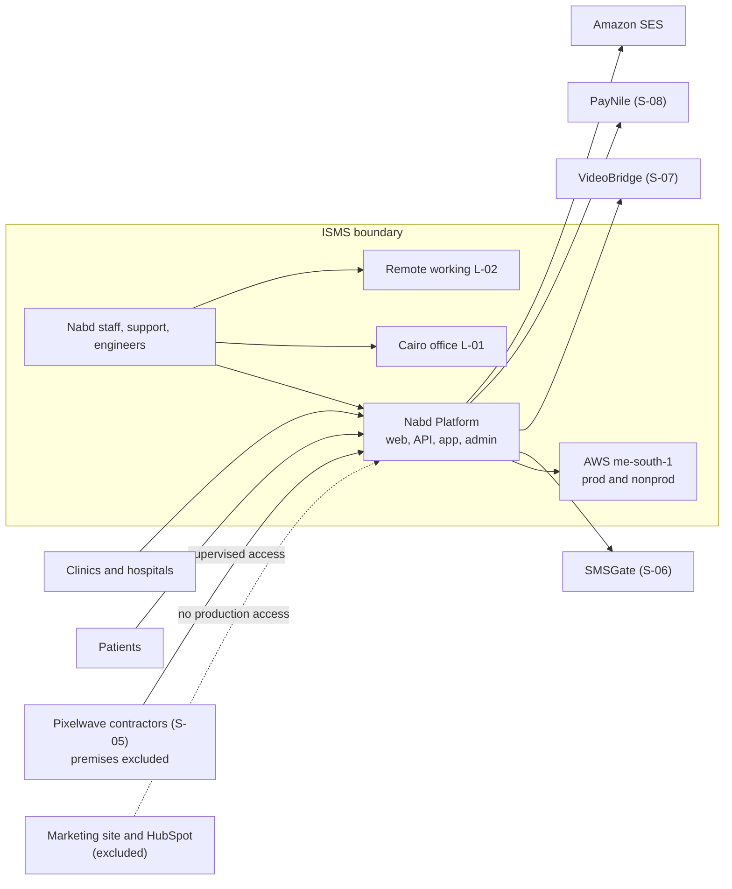

# ISMS Scope

| Field | Value |
|---|---|
| Document ID | NH-CTX-003 |
| Version | 1.0 |
| Status | Approved |
| Simulation date | 27 November 2026 |
| Owner | ISMS Lead Implementer |
| Approved by | Karim Salah, CEO; Omar Nasser, CTO |
| Classification | Internal (simulated client confidential) |

> **Simulation notice:** Nabd Health is fictional. This document is part of a simulated
> ISO/IEC 27001:2022 implementation and does not describe a real organization.

## 1. Purpose

This document defines the scope and boundaries of the information security management
system (ISMS) for Nabd Health, as required by ISO/IEC 27001:2022 clause 4.3. It states
what is included, what is excluded, why, and how the interfaces to excluded areas are
controlled.

## 2. Scope statement

> The ISMS of Nabd Health for Digital Health Solutions S.A.E. covers the development,
> hosting, operation, support, and continuous improvement of the Nabd Platform: the
> Nabd Booking, Nabd Records, Nabd Connect, Nabd Billing, Nabd Patient App, and Nabd
> Admin Panel services: including the supporting AWS accounts `nabd-prod` and
> `nabd-nonprod`, the Cairo office at L-01, and remote working by Nabd staff and
> supervised Pixelwave contractors, in accordance with ISO/IEC 27001:2022 (including
> Amendment 1:2024) and the requirements of interested parties recorded in NH-CTX-002.

## 3. Boundaries

### 3.1 Organizational units in scope

| Unit | Included activities | Notes |
|---|---|---|
| Executive | ISMS governance, risk decisions, management review | CEO is ISMS sponsor |
| Engineering | Platform and mobile development, infrastructure, CI/CD, production operations | Includes 3 Pixelwave contractors under supervision |
| Product and Design | Requirements, design, product data handling | Security requirements in the product lifecycle |
| Support and Operations | Clinic onboarding, support access to patient records, incident intake | Admin Panel use is a critical scope element |
| Finance, HR and Admin | Employment lifecycle, supplier contracts, office security, payroll data | Support functions whose failure affects in-scope services |
| Sales and Marketing | Customer security questionnaires and contractual security commitments | Marketing systems themselves are excluded (Section 4) |

### 3.2 Services in scope

| Service | Description | Primary data |
|---|---|---|
| Nabd Booking | Appointment booking and reminders | Patient identifiers, appointment details |
| Nabd Records | Electronic patient records | Sensitive health data |
| Nabd Connect | Telemedicine video and chat | Live audio/video, session metadata |
| Nabd Billing | Invoicing, card and wallet payments, insurance exports | Payment tokens, billing data |
| Nabd Patient App | iOS and Android patient application | Patient account and health data |
| Nabd Admin Panel | Internal support and operations tool | All tenant data, including patient records |
| Supporting infrastructure | AWS accounts, Terraform, GitHub, CI/CD, monitoring | Source code, secrets, logs |

### 3.3 Locations in scope

| ID | Location | Scope treatment |
|---|---|---|
| L-01 | Cairo office, 5th Settlement, New Cairo | In scope: people, endpoints, network cupboard, physical access, visitor management |
| L-02 | Remote work locations across Greater Cairo and Alexandria | In scope through remote working, endpoint, and access controls |
| L-03 | AWS Middle East region (Bahrain, me-south-1) | In scope: production and non-production workloads and data |
| L-04 | Pixelwave Software office, Giza | **Excluded premises.** Pixelwave personnel and their access are in scope through supplier and access controls |

### 3.4 Technology in scope

- AWS organization, management account, `nabd-prod`, and `nabd-nonprod`.
- Amazon ECS Fargate, RDS PostgreSQL, S3, ElastiCache, SQS, SES, CloudFront, WAF,
  GuardDuty, CloudTrail, CloudWatch, Secrets Manager, ECR, and the bastion host.
- GitHub organization `nabd-health`, GitHub Actions, and Terraform state.
- Google Workspace identity, Slack, Jira, Confluence, Freshdesk, HubSpot (support and
  customer records only), Figma, Sentry, and the payroll/accounting platform.
- Managed and unmanaged endpoints used to access in-scope systems, including contractor
  and personal devices where they hold or access Nabd data.

### 3.5 Processes in scope

- Information security governance, risk assessment, and risk treatment.
- Identity and access management, including joiners, movers, leavers, privileged access,
  and periodic access review.
- Secure development, change management, release, and production support.
- Asset management, data classification, retention, and secure disposal.
- Incident management, business continuity, and disaster recovery.
- Supplier security management and customer security commitments.
- Physical and environmental security at L-01.
- Awareness, training, internal audit, management review, and corrective action.

## 4. Exclusions and justification

| Excluded item | Justification | Interface control | Residual risk |
|---|---|---|---|
| Marketing website and analytics | Public content only; no patient or customer personal data beyond marketing leads; no connection to production | Separate hosting and accounts; no production credentials; content managed by Sales and Marketing | Accepted low; reviewed annually |
| HubSpot marketing activities | Marketing leads and campaign data are outside the platform's patient data flows | Support use of HubSpot is in scope; marketing automation is not; access controlled by Google SSO | Accepted low; supplier terms reviewed |
| Pixelwave premises (L-04) | Nabd does not control the supplier's office or devices | Contractor access is in scope; supplier security policy, confidentiality terms, access reviews, and endpoint requirements apply | Transferred and controlled through supplier treatment (R-05, R-17) |
| PayNile card processing environment | Nabd does not store or process card numbers; payment pages are hosted by PayNile | Supplier assurance; no card data in Nabd systems; PCI status verified annually | Transferred to PayNile; monitored (R-15) |
| VideoBridge media infrastructure | Live media is carried by the supplier and not recorded by Nabd | Supplier assurance, DPA, and session metadata controls | Transferred to VideoBridge; monitored (R-15) |

Exclusions do not remove Nabd's responsibility to manage the security of interfaces. Any
change that brings an excluded item into contact with in-scope data requires a scope
review before the change is approved.

## 5. Interfaces and dependencies

| Dependency | Direction | Security requirement | Owner |
|---|---|---|---|
| AWS | Critical hosting | Security and compliance reports, shared responsibility, region resilience | CTO |
| GitHub | Source and CI | Organization 2FA, branch protection, secret scanning, audit log | CTO |
| Google Workspace | Identity and email | MFA enforcement, admin controls, log export | IT Support Officer |
| Pixelwave | Development capacity | Confidentiality, security terms, least privilege, offboarding | CTO |
| SMSGate | OTP and reminders | DPA, delivery integrity, number protection | CTO |
| VideoBridge | Telemedicine media | DPA, encryption, incident notification | CPO |
| PayNile | Payments | PCI status evidence, DPA, no card data in Nabd | CFO |
| Landlord | Building security | Visitor control, access coordination, incident escalation | Office Manager |

## 6. Application of the standard

All requirements of ISO/IEC 27001:2022 clauses 4 to 10 apply. All 93 controls in Annex A
were assessed; two are not applicable and are justified in the Statement of
Applicability (NH-SOA-001). The remaining controls are applicable and are implemented or
planned as recorded in that document.

## 7. Scope maintenance

The scope is reviewed:

- at least annually as part of management review;
- before onboarding a new customer segment, service, or region;
- before a significant architecture or supplier change;
- after an acquisition, divestment, or material change to the legal context.

Changes to scope are approved by the CEO and recorded in the revision history.

## 8. Revision history

| Version | Date | Change | Author |
|---|---|---|---|
| 1.0 | 27 November 2026 | Initial scope approved after gap analysis and management workshop | ISMS Lead Implementer |
