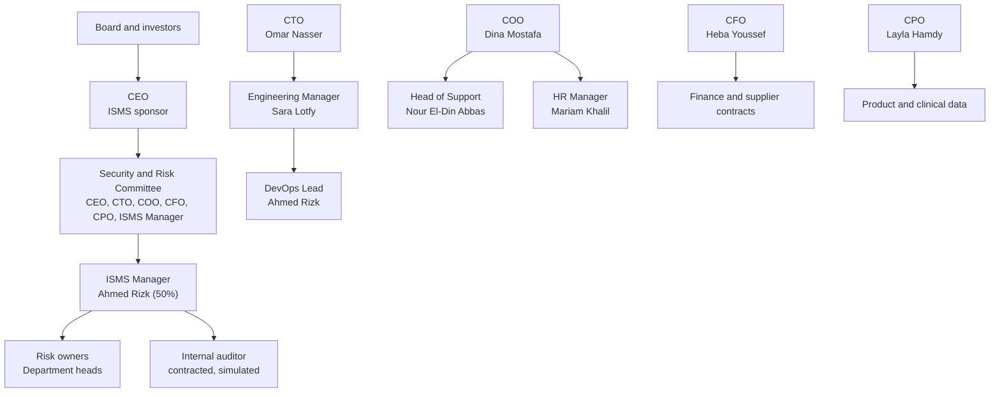

# ISMS Roles, Responsibilities and RACI

| Field | Value |
|---|---|
| Document ID | NH-ROL-001 |
| Version | 1.0 |
| Status | Approved |
| Simulation date | 15 December 2026 |
| Owner | ISMS Lead Implementer |
| Approved by | Karim Salah, CEO |
| Classification | Internal (simulated client confidential) |

> **Simulation notice:** Nabd Health is fictional. This document is part of a simulated
> ISO/IEC 27001:2022 implementation and does not describe a real organization.

## 1. Purpose

This document defines the governance structure, accountabilities, and decision rights
for the ISMS. It supports ISO/IEC 27001:2022 clauses 5.2, 5.3, and 7.2, and the roles
referenced in the information security policy (NH-POL-001).

## 2. Governance structure

The Security and Risk Committee meets quarterly and after any critical incident. It
reviews the risk register, KPI performance, incidents, audit findings, and treatment
progress, and makes decisions within the risk appetite approved by the CEO.

## 3. Role descriptions

### 3.1 CEO: ISMS sponsor

- Accountable to the board for information security and the ISMS.
- Approves the information security policy, scope, risk appetite, and material risk
  acceptances.
- Chairs management review and the Security and Risk Committee.
- Ensures resources and resolves cross-functional conflicts.
- Holds the certification relationship and represents security to customers, investors,
  and the board.

### 3.2 CTO: technology and security owner

- Owns the technology risk portfolio and the operational ISMS.
- Approves technical standards, architecture decisions, and access exceptions within
  delegated authority.
- Ensures engineering, infrastructure, and production controls are implemented and
  evidenced.
- Acts as deputy ISMS sponsor in the CEO's absence.

### 3.3 ISMS Manager

- Maintains the ISMS documentation set and the document index.
- Coordinates risk assessment, treatment planning, and the Statement of Applicability.
- Plans and coordinates internal audit and corrective actions with the contracted
  auditor (simulated).
  auditor.
- Tracks KPIs, prepares management review inputs, and reports on ISMS performance.
- Maintains the legal and contractual requirements register with the CFO.
- Allocated 50 percent of working time during implementation and 20 percent after
  certification.

### 3.4 Risk owners

- Understand and own the risks assigned in NH-REG-002.
- Approve treatment actions, owners, and target dates.
- Provide evidence that treatment is operating.
- Report changes in risk status to the ISMS Manager.
- Formally accept residual risk within their delegated authority.

### 3.5 Asset owners

- Maintain accurate asset information in the asset register.
- Approve access requests and review access periodically.
- Ensure classification and handling requirements are applied.
- Confirm secure disposal and return of assets.

### 3.6 Engineering Manager

- Ensures secure development, code review, dependency management, and testing practices.
- Owns the change management process and release quality.
- Ensures security requirements are included in product and project planning.

### 3.7 DevOps Lead

- Operates production access control, secrets management, backups, monitoring,
  vulnerability management, and infrastructure configuration.
- Maintains runbooks and recovery procedures.
- Acts as first technical responder to security incidents.
- Maintains the privileged access inventory and access review evidence.

### 3.8 Head of Support and Operations

- Owns Admin Panel use, support ticket handling, and customer incident communication.
- Ensures patient data is not copied into tickets or chat unnecessarily.
- Approves support access to patient records and reviews it periodically.

### 3.9 HR Manager

- Runs screening, employment terms, onboarding, awareness, and offboarding.
- Maintains training and acknowledgement records.
- Ensures leaver notifications reach IT and the DevOps Lead before the last working day.

### 3.10 CFO

- Owns supplier contracts, legal and regulatory coordination, privacy governance, and
  cyber insurance.
- Maintains the records of processing and the cross-border transfer assessment with
  counsel.
- Ensures breach notification obligations are understood and funded.

### 3.11 All staff and contractors

- Follow the information security policy and topic-specific policies.
- Protect devices, credentials, and information in their care.
- Report suspected incidents, phishing, and weaknesses promptly.
- Complete required awareness training.
- Return assets and access at the end of employment or engagement.

## 4. Decision rights

| Decision | Approve | Consult | Informed |
|---|---|---|---|
| Information security policy | CEO | CTO, CFO, COO, CPO | All staff |
| ISMS scope | CEO | CTO, COO, CFO | Security and Risk Committee |
| Risk appetite and risk criteria | CEO | CTO, CFO, COO, CPO | Committee |
| Risk acceptance, medium | CTO or relevant C-suite risk owner | ISMS Manager | Committee |
| Risk acceptance, high or critical | CEO | Risk owner, CFO | Board |
| New critical supplier | CFO | CTO, ISMS Manager | CEO |
| Exception to access control | CTO | ISMS Manager | Asset owner |
| Production change, normal | Engineering Manager | DevOps Lead | Product owner |
| Production change, emergency | CTO or delegate | DevOps Lead | Engineering Manager |
| Incident severity 1 | CEO | CTO, CFO, COO, CPO | Board, affected customers |
| Privacy breach notification | CFO with counsel | CEO, CTO | Regulator, customers |
| Internal audit report | CEO | Audit lead, ISMS Manager | Committee |
| Corrective action closure | ISMS Manager | Action owner | Committee |

## 5. RACI for ISMS activities

R = Responsible, A = Accountable, C = Consulted, I = Informed.

| Activity | CEO | CTO | ISMS Mgr | Risk owner | HR | CFO | DevOps | Eng Mgr | All staff |
|---|---|---|---|---|---|---|---|---|---|
| Define ISMS scope | A | R | C | I | I | C | I | I | I |
| Maintain context and interested parties | A | C | R | C | C | C | I | I | I |
| Information security policy | A/R | C | C | I | I | C | I | I | I |
| Risk assessment | A | C | R | R | C | C | C | C | I |
| Risk treatment plan | A | C | R | R | C | C | R | R | I |
| Statement of Applicability | A | C | R | C | I | C | C | C | I |
| Access control operation | I | A | C | C | C | I | R | C | R |
| Onboarding and offboarding | I | C | C | C | A/R | I | R | C | C |
| Security awareness | I | C | C | C | A/R | I | I | C | R |
| Incident response | A | R | C | C | I | C | R | C | R |
| Backup and restore testing | I | A | C | I | I | I | R | I | I |
| Supplier security | I | C | C | C | I | A/R | C | I | I |
| Vulnerability management | I | A | C | I | I | I | R | R | I |
| Change management | I | A | I | I | I | I | R | R | C |
| Internal audit | A | C | R | C | I | C | C | C | I |
| Management review | A/R | R | R | C | C | R | C | C | I |
| Corrective actions | I | C | A | R | R | C | R | R | I |
| KPI reporting | A | C | R | C | C | C | C | C | I |

## 6. Competence and training

Role holders must be able to demonstrate the competence required by their ISMS
responsibilities. The ISMS Manager maintains a competence matrix covering ISO/IEC
27001:2022 awareness, risk assessment, incident response, secure development, privacy,
and internal audit. Records are held with HR.

Where competence gaps are identified, training is planned, funded, and its effectiveness
evaluated. The internal auditor must be separate from the activities audited and must
have audit competence; where internal competence is insufficient, an external
competent auditor is contracted.

## 7. Deputies and continuity

| Role | Deputy |
|---|---|
| CEO / ISMS sponsor | COO |
| CTO | Engineering Manager |
| ISMS Manager | Engineering Manager |
| DevOps Lead | CTO and second platform engineer |
| Head of Support | Support team lead |
| HR Manager | HR Officer |
| CFO | Finance Manager |

Deputies are recorded so that absences do not leave a control unowned. Key-person
dependency is tracked as risk R-25.

## 8. Review and revision history

| Version | Date | Change | Author |
|---|---|---|---|
| 1.0 | 15 December 2026 | Initial roles and RACI approved | ISMS Lead Implementer |

Reviewed annually with the information security policy.
