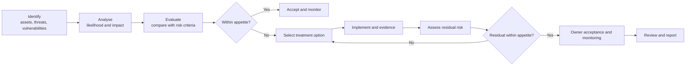

# Risk Assessment and Treatment Methodology

| Field | Value |
|---|---|
| Document ID | NH-RISK-001 |
| Version | 1.0 |
| Status | Approved |
| Simulation date | 8 January 2027 |
| Owner | ISMS Lead Implementer |
| Approved by | Karim Salah, CEO; Omar Nasser, CTO |
| Classification | Internal (simulated client confidential) |

> **Simulation notice:** Nabd Health is fictional. This document is part of a simulated
> ISO/IEC 27001:2022 implementation and does not describe a real organization.

## 1. Purpose

This document defines how Nabd Health identifies, analyses, evaluates, treats, and
monitors information security risk. It implements ISO/IEC 27001:2022 clauses 6.1.2 and
6.1.3 and establishes the criteria used in the risk register (NH-REG-002), the risk
treatment plan (NH-PLN-001), and the Statement of Applicability (NH-SOA-001).

## 2. Scope and risk definition

The methodology applies to all information and assets within the ISMS scope (NH-CTX-003).

**Information security risk** is the effect of uncertainty on Nabd Health's objectives
related to the confidentiality, integrity, and availability of information. Risks are
described as an event and its consequence, for example: "An attacker uses a compromised
administrator account to access patient records, causing regulatory breach and loss of
hospital contracts."

Risk assessment considers:

- **Confidentiality** — unauthorized disclosure of patient, customer, employee, or
  business information.
- **Integrity** — unauthorized or accidental alteration of records, code, or
  configuration.
- **Availability** — disruption of the platform, support, or recovery capability.
- **Compliance** — failure to meet legal, regulatory, contractual, or certification
  obligations.
- **People and safety** — harm to patients or staff arising from a security failure.

## 3. Risk assessment process

### 3.1 Identification

Risks are identified from:

- the company fact base (NH-FB-001), including 22 baseline gaps (G-01 to G-22);
- the asset register (NH-REG-001) and data inventory;
- the context and interested-party registers (NH-CTX-001, NH-CTX-002);
- incidents, near misses, audit findings, supplier assessments, and threat intelligence;
- legal and contractual requirements;
- change proposals, projects, and new suppliers.

Each risk is linked to the gap, asset, and Annex A controls that explain it. If a risk
does not trace to a fact, asset, or requirement, the fact base is updated first.

### 3.2 Analysis

Each risk is assessed on inherent likelihood and impact before considering existing
controls. Existing controls are recorded so that the assessment is not artificially
pessimistic or optimistic; the score reflects the risk as it currently stands.

## 4. Risk criteria

### 4.1 Likelihood

| Score | Rating | Definition |
|---|---|---|
| 1 | Rare | Not expected within five years; requires multiple unlikely conditions |
| 2 | Unlikely | Could occur within two to five years |
| 3 | Possible | Could occur within one to two years |
| 4 | Likely | Could occur within six to twelve months, or has occurred once |
| 5 | Almost certain | Expected multiple times per year, or is already occurring |

Likelihood considers threat capability and motivation, exposure, ease of exploitation,
existing control strength, and the number of people or systems involved.

### 4.2 Impact

| Score | Rating | Patient and data | Regulatory and contractual | Financial | Operational | Reputation |
|---|---|---|---|---|---|---|
| 1 | Insignificant | No personal data; internal only | No reportable obligation | Under EGP 100k | No customer impact | Local, contained |
| 2 | Minor | Small internal dataset; no sensitive data | Internal policy breach | EGP 100k to 500k | Minor degradation | Limited customer concern |
| 3 | Moderate | Limited patient data; contained | Reportable event possible; contract discussion | EGP 500k to 2m | Partial service degradation | Regional media or customer escalation |
| 4 | Major | Sensitive health data of many patients; or code/infrastructure compromise | Regulatory investigation; 72-hour notification; contract at risk | EGP 2m to 10m | Platform unavailable for several hours | National media; hospital tender loss |
| 5 | Severe | Widespread sensitive health data; patient harm; or prolonged outage | Enforcement action; multiple contract losses; certification blocked | Over EGP 10m | Platform unavailable for more than one day or data unrecoverable | Sustained loss of trust; investor impact |

Impact is assessed at the highest credible level across the dimensions, not the average.

### 4.3 Risk matrix

| Likelihood \ Impact | 1 Insignificant | 2 Minor | 3 Moderate | 4 Major | 5 Severe |
|---|---|---|---|---|---|
| **5 Almost certain** | 5 M | 10 H | 15 H | 20 C | 25 C |
| **4 Likely** | 4 L | 8 M | 12 H | 16 H | 20 C |
| **3 Possible** | 3 L | 6 M | 9 M | 12 H | 15 H |
| **2 Unlikely** | 2 L | 4 L | 6 M | 8 M | 10 H |
| **1 Rare** | 1 L | 2 L | 3 L | 4 L | 5 M |

Score = likelihood × impact.

| Rating | Score | Colour | Meaning |
|---|---|---|---|
| Low | 1–4 | Green | Acceptable; monitor |
| Medium | 5–9 | Amber | Treat or formally accept; owner accountable |
| High | 10–16 | Orange | Treat within the quarter; CTO oversight |
| Critical | 17–25 | Red | Immediate treatment; CEO and board notified |

### 4.4 Risk appetite

Nabd Health's risk appetite is deliberately conservative for patient data and
availability:

- **Low (1–4):** accepted and monitored through normal operations.
- **Medium (5–9):** acceptable only with a named risk owner and a treatment or
  acceptance decision recorded.
- **High (10–16):** must be treated; residual must be reduced to Medium or lower before
  the risk is accepted.
- **Critical (17–25):** treatment is mandatory and reported to the CEO and board. No
  new critical risk may remain untreated for more than 30 days.

No risk involving unauthorized disclosure of patient data may be accepted at High or
Critical without CEO approval and a documented legal assessment.

### 4.5 Acceptance authority

| Residual rating | Acceptance authority |
|---|---|
| Low | Risk owner |
| Medium | CTO or relevant C-suite risk owner |
| High | CEO |
| Critical | CEO and board; not permitted without a time-bound remediation plan |

Acceptance is recorded in the risk register with the residual score, justification,
expiry date, and the approving person's name.

## 5. Treatment

### 5.1 Options

| Option | Description | When used |
|---|---|---|
| Mitigate | Implement controls to reduce likelihood or impact | Default for High and Critical risks |
| Transfer | Contractual transfer, insurance, or supplier responsibility | Supplier and payment risks, where liability can be allocated |
| Avoid | Stop the activity or remove the exposure | Where risk cannot be managed within appetite |
| Accept | Retain the risk with informed approval | Low risks and residual risk within appetite |

### 5.2 Treatment planning

Each treatment action has:

- a unique action ID and the risk it addresses;
- a specific deliverable or control change;
- an accountable owner and due date;
- the expected effect on likelihood and impact;
- the evidence that will demonstrate completion;
- the residual score after treatment.

Actions that depend on a supplier or a third party record the dependency and escalation
route. Actions that are not completed by the due date are escalated to the Security and
Risk Committee and recorded as overdue in KPI reporting.

### 5.3 Residual risk

Residual risk is assessed after the treatment has operated for a sufficient period to
provide evidence. The residual score is not a prediction that the risk is eliminated; it
states the remaining exposure assuming the controls operate as designed.

If the residual score remains above appetite, additional treatment is required or the
risk is escalated for formal acceptance. Residual risk is reviewed at least quarterly
for Critical and High risks and annually for the rest.

## 6. Risk ownership and review

| Risk rating | Review frequency | Report to |
|---|---|---|
| Critical | Monthly until reduced; then quarterly | CEO, board, Security and Risk Committee |
| High | Quarterly | CTO, Security and Risk Committee |
| Medium | Every six months | Risk owner, ISMS Manager |
| Low | Annually | Risk owner |

Reviews consider changes in threats, assets, suppliers, incidents, audit findings, legal
requirements, and the effectiveness of controls. The risk register is a living document;
scores and statuses are updated when evidence changes.

## 7. Integration with the ISMS

- **Statement of Applicability:** every Annex A control is assessed against the risks it
  addresses. Justifications reference risk IDs and the reason for any exclusion.
- **Objectives and KPIs:** treatment progress, overdue actions, and residual risk are
  reported in NH-KPI-001.
- **Internal audit:** audits test whether treatment actions have been implemented and
  whether controls operate effectively, not only whether documents exist.
- **Management review:** reviews the risk profile, appetite breaches, treatment progress,
  and accepted risks.
- **Incidents:** an incident triggers a review of the related risks and may create new
  risks or change scores.
- **Suppliers:** supplier assessments use the same likelihood and impact scales.

## 8. Records

The following records are retained for at least three years, or longer where required by
law or contract:

- risk assessment results and scoring decisions;
- risk treatment plans and evidence of completion;
- risk acceptance decisions and expiry dates;
- risk review minutes and changes to scores;
- supplier risk assessments;
- incident and audit records that affect risk.

## 9. Roles

| Role | Responsibility |
|---|---|
| CEO | Approves methodology, appetite, and High/Critical acceptance |
| CTO | Owns technology risks and ensures treatment is resourced |
| ISMS Manager | Facilitates assessment, maintains the register, tracks actions, reports performance |
| Risk owners | Assess, treat, evidence, and review their risks |
| Internal auditor | Tests the process and the effectiveness of treatment |
| All staff | Report changes, incidents, and weaknesses that affect risk |

## 10. Revision history

| Version | Date | Change | Author |
|---|---|---|---|
| 1.0 | 8 January 2027 | Initial methodology approved before the risk workshop | ISMS Lead Implementer |

Reviewed annually with the risk register, or earlier after a material change.
